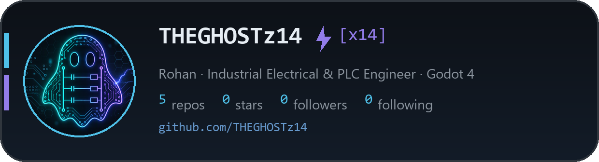

  

  

  

  # Rohan · `THEGHOSTz14`

  ### Industrial Electrical & PLC Engineer · Godot game dev · automating the boring parts

  Gurgaon, India · *Cosmo Instruments* · I write code that either runs a plant or runs in a browser

  <em>“Struggle, endure, contend. For that alone is the sword of one who defies death.”</em> — Berserk

  <picture>
    <source media="(prefers-color-scheme: dark)" srcset="https://readme-typing-svg.demolab.com/?font=Fira%20Code&center=true&width=360&height=44&color=e0533d&vCenter=true&size=19&pause=1000&lines=Rohan%20from%20Gurgaon;Industrial%20%26%20PLC%20engineer;Godot%204%20%2B%20GDScript;Automating%20the%20boring%20parts" />
    <source media="(prefers-color-scheme: light)" srcset="https://readme-typing-svg.demolab.com/?font=Fira%20Code&center=true&width=360&height=44&color=8b1a1a&vCenter=true&size=19&pause=1000&lines=Rohan%20from%20Gurgaon;Industrial%20%26%20PLC%20engineer;Godot%204%20%2B%20GDScript;Automating%20the%20boring%20parts" />
    
  </picture>

    

  ---

### 🩸 About me

- 🔭 **Building** → *Drone vs Droids* (repo `GHOST_WEB_GAME-`) — a Godot 4.7 arcade game exported to WASM for the y8 browser portal
- 🏭 **Day job** → panel design, PLC programming, VFD & servo commissioning, plant troubleshooting
- 🌱 **Learning** → C#, computer vision with YOLO, and finishing projects instead of starting them
- 💬 **Ask me about** → ladder logic, 24 V sensor wiring, why a contactor chatters, Godot web exports
- ⚡ **Method** → I debug PLCs with a multimeter and games with `print()`. Both work.

### ⚔️ GitHub stats

## 🗡️ Tech stack

**Languages & scripting**

         

**Web**

          

**AI / CV / data**

           

**Game dev & 3D**

       

**PLC & automation platforms**

              

**Electrical design & simulation**

          

**Tooling, OS & cloud**

                     

**Hardware & IoT**

    

## 🏹 Things I have shipped

## 🔥 Activity

<!-- github-snake.svg is regenerated nightly by .github/workflows/snake.yml -->

<picture>
<source media="(prefers-color-scheme: dark)" srcset="https://raw.githubusercontent.com/THEGHOSTz14/THEGHOSTz14/github-snake/github-snake-dark.svg" />
<source media="(prefers-color-scheme: light)" srcset="https://raw.githubusercontent.com/THEGHOSTz14/THEGHOSTz14/github-snake/github-snake.svg" />

</picture>

## 📫 Reach me

 

> Prefer the noreply address — it reaches me and keeps the inbox out of public git history.

  

> `while (alive) { learn(); build(); ship(); }`

  

